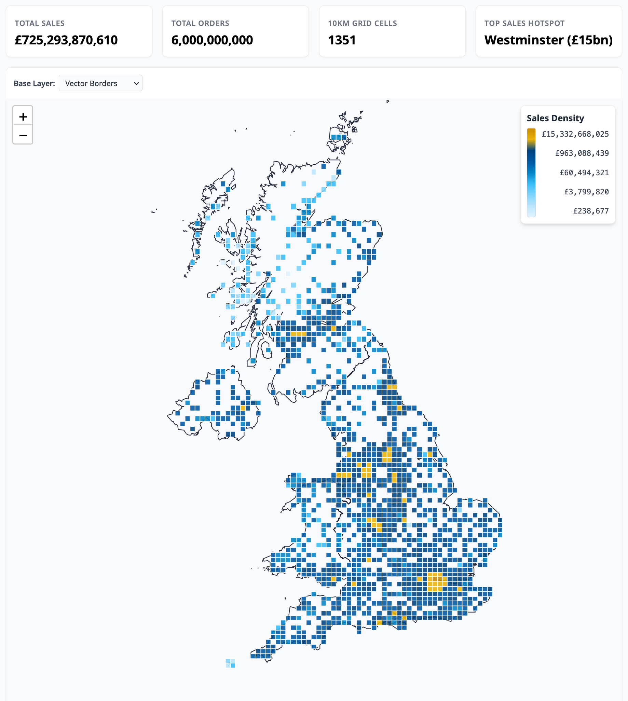
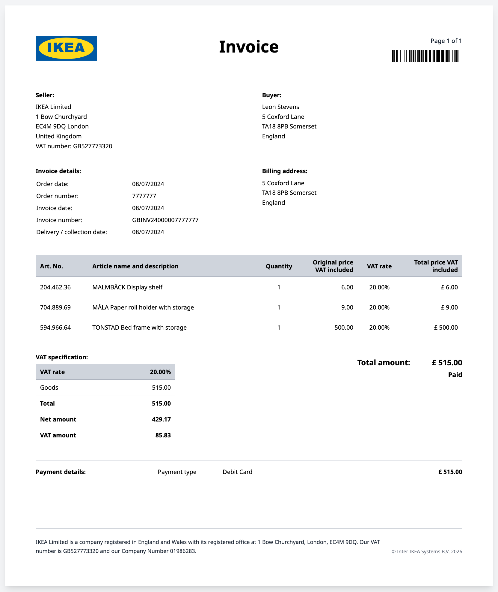
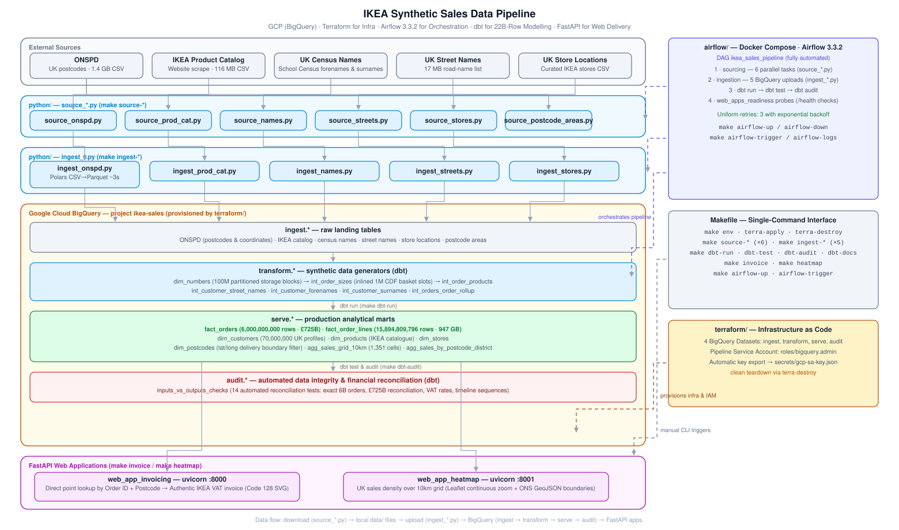
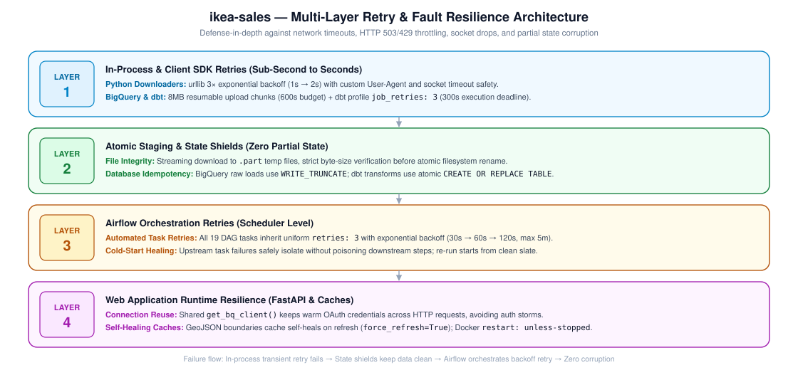

# 1. IKEA Synthetic Sales Data Pipeline

An end-to-end synthetic data pipeline that generates 22 billion e-commerce order rows in less than 10 minutes, for less than £10.

<p align="center">
   
  
</p>

<br>

# 2. Table of Contents

- [1. Project Overview](#1-ikea-synthetic-sales-data-pipeline)
- [2. Table of Contents](#2-table-of-contents)
- [3. Problem Statement](#3-problem-statement)
- [4. Architecture](#4-architecture)
- [5. Running Time and Costs](#5-running-time-and-costs)
- [6. Repo Structure](#6-repo-structure)
- [7. Setup](#7-setup)
  - [7.1. Prerequisites](#71-prerequisites)
  - [7.2. Environment Configuration](#72-environment-configuration)
  - [7.3. Service Account Credentials](#73-service-account-credentials)
  - [7.4. Provision Infrastructure](#74-provision-infrastructure)
- [8. Running Instructions](#8-running-instructions)
  - [8.1. Option A: Automated Pipeline via Airflow](#81-option-a-automated-pipeline-via-airflow)
  - [8.2. Option B: Manual Step-by-Step via Makefile](#82-option-b-manual-step-by-step-via-makefile)
  - [8.3. Cleanup](#83-cleanup)
- [9. Viewing The Results Via Web Applications](#9-viewing-the-results-via-web-applications)
  - [9.1. Invoicing Web App](#91-invoicing-web-app)
  - [9.2. Geographic Sales Heatmap Web App](#92-geographic-sales-heatmap-web-app)
- [10. Known Issues](#10-known-issues)
- [11. Data Sources](#11-data-sources)
- [12. Licence](#12-licence)

<br>

# 3. Problem Statement

- There is a need for large-scale, production-grade e-commerce sales datasets for data engineering projects.
- Public commercial sales datasets are virtually non-existent at scale.
- Real retailer data cannot be published due to commercial confidentiality and GDPR; results cannot be reproduced publicly even if a data engineer acquired access to a real company data.
- LLM generation at scale (10 billion+ rows) is prohibitively slow and may cost tens of thousands of pounds in API tokens.
- **Solution**: Generate a deterministic, scalable, mathematically rigorous synthetic dataset with 22 billion detail rows, 6 billion orders and 70 million customers, in less than 10 minutes, for less than £10 in cloud compute, with zero LLM API costs.

<br>

# 4. Architecture



Pipeline flow:
1. **Source**: Download external seed data via Python scripts (`python/source_*.py`).
2. **Ingest**: Convert to typed columnar Parquet and stream upload directly to BigQuery raw landing tables (`python/ingest_*.py`).
3. **Transform**: dbt generates synthetic entities, dimensional models, and marts (`dbt/models/`).
4. **Audit**: dbt reconciliation tests verify financial accuracy and dimensional counts against input seeds.
5. **Serve**: Deliver data to downstream FastAPI web applications (`web_app_invoicing/` and `web_app_heatmap/`).
6. **Orchestrate**: Airflow orchestrates the DAG with automated task-level retries.


Core mechanisms enabling sub-10-minute generation of 22 billion rows without data hallucinations:

1. **Storage-Driven Slot Parallelism (`int_number_expansion`)**:
   BigQuery's in-memory `GENERATE_ARRAY()` runs on a single worker slot (`parallelInputs = 1`). Materializing 150M sequence numbers (~1.15 GB) to storage partitions forces BigQuery to read via multi-slot storage blocks, immediately engaging 200+ parallel workers and generating 6 billion IDs in seconds.

2. **Fault Resilience & Retry Architecture**:
   To ensure cold-start execution integrity across external scrapers and long-running warehouse transformations, the pipeline implements a 4-layer defense-in-depth shield: in-process client SDK retries (`urllib` 3× exponential backoff, BigQuery 8MB resumable chunk uploads with 600s budgets, and dbt `job_retries: 3`), atomic zero-corruption staging (`.part` streaming temp files with byte-size verification before rename, `WRITE_TRUNCATE` table loads, and atomic `CREATE OR REPLACE TABLE` dbt models), uniform Airflow task retries (`retries: 3` with exponential backoff across all 19 DAG tasks), and web app runtime resilience with warm BigQuery client session pooling and self-healing memory caches.

   

3. **Discrete CDF Slotting for O(1) Broadcast Equi-Joins**:
   Arbitrary non-uniform continuous and discrete probability distributions (Pareto, geometric basket sizes, product popularity) are pre-calculated into a 1,000,000-row discrete integer slot lookup table. Random sampling reduces to `MOD(ABS(FARM_FINGERPRINT(...)), 1000000)` joined via integer equi-joins. BigQuery broadcasts the 1M-row lookup table into worker RAM, making 16-billion-row lookups fast and fully deterministic.

4. **Streaming CSV-to-Parquet Pre-Processing**:
   Raw text parsing in BigQuery on multi-GB files (e.g. 1.4 GB ONSPD) takes 40–60s and suffers from loose type inference. Streaming raw CSVs locally through Polars (`scan_csv().sink_parquet()`) produces compressed columnar Parquet in ~3s. BigQuery loads Parquet directly, bypassing text parsing bottlenecks.

5. **Nested Line Items & Zero-Join Order Retrieval (`fact_orders`)**:
   Instead of storing order headers and order lines in separate tables that require expensive multi-billion-row shuffle joins to recombine, `fact_orders` pairs order-level attributes (`customer_id`, `payment_method`, `delivery_type`, timestamps, totals) directly with a nested `ARRAY<STRUCT>` of item details (`product_id`, `unit_price`, `unit_vat`).
   - **Zero-Join Reads**: Point lookups (such as generating a customer's VAT invoice) read the entire order and all its line items from a single clustered row with no table joins.
   - **Columnar Skipping**: Downstream aggregations (such as the 10km grid sales mart) scan only the header columns and completely skip reading the nested item arrays.
   - **Relational View Flexibility**: A flat `fact_order_lines` view is provided for traditional BI tools by unnesting on the fly, with zero duplicate storage cost.

6. **Lossless Integer Minor-Units Currency**:
   All monetary amounts are stored as integer minor units (`INT64` pence). Eliminates IEEE 754 floating-point inaccuracies, rounding divergence between rollups, and overhead across all models.

<br>

# 5. Running Time and Costs

Below are the results of a cold-start Airflow DAG run at 2026-10-27 22:26:53.

| Layer | Running Time | BigQuery Costs | Data Scanned | What it Does |
|---|---|---|---|---|
| **Source** | **33s** | **£0.00** *(free)* | ~1.5 GB | Scrapes external seed data (OS, ONS Census, IKEA website) |
| **Ingest** | **39s** | **£0.00** *(free)* | ~1.5 GB | Polars streaming $\to$ typed Parquet $\to$ BigQuery raw landing |
| **Transform** | **1m 14s** | **£0.004** *(< 1p)* | 0.87 GB | Intermediate sequence driver (`int_number_expansion`) & basket sizes (`int_order_sizes`) |
| **Serve** | **3m 07s** | **£1.48** | 315.4 GB | Generates 6B `fact_orders`, 15.9B `fact_order_lines`, 70M `dim_customers`, & 10km grid mart |
| **Audit** | **15s** | **£1.65** | 350.6 GB | Reconciles financials, counts & 31 statistical distributions; tests verify summary in 1s |
| **Total** | **5m 48s** | **£3.13** | **667 GB** | **Full cold start end-to-end pipeline run** |

**Key Takeaways**

1. **Serve Layer generates 22 Billion Rows for just £1.48**:
   Writing 6 billion clustered orders and 15.9 billion clustered order lines costs less than a cup of coffee - at Greggs.

2. **Audit-First Testing Cuts Bill by 38% (£5.07 $\to$ £3.13)**:
   By materialising reconciliation metrics once into `inputs_vs_outputs_checks` (351 GB) and asserting zero `FAIL` rows in `dbt test` in 1 second (0 GB), the audit layer scan dropped from 764 GB to 351 GB, eliminating duplicate 22-billion-row full scans and saving £1.94 per run.


<br>

# 6. Repo Structure

```
├── airflow/            # Airflow DAG, Dockerfile, docker-compose configuration
├── data/               # Local seed data storage (git-ignored)
├── dbt/                # dbt models (ingest, transform, serve, audit), macros, tests
├── etc/                # Architecture diagrams, retry diagrams, screenshots
├── python/             # Sourcing (source_*.py) and ingestion (ingest_*.py) scripts
├── secrets/            # GCP & Terraform service account keys (git-ignored)
├── terraform/          # Terraform configuration for BigQuery datasets and IAM resources
├── web_app_heatmap/    # FastAPI + Leaflet UK sales 10km grid heatmap app
├── web_app_invoicing/  # FastAPI + Code128 barcode UK VAT invoice app
├── .env_example        # Environment variable template
├── .gitignore          # Git exclusion rules
├── .python-version     # Python version
├── LICENSE             # Licence
├── Makefile            # Single-command pipeline interface
├── pyproject.toml      # Python dependencies and project settings
└── uv.lock             # Pinned dependency lockfile
```

<br>

# 7. Setup

## 7.1. Prerequisites

- GCP account with billing enabled
- BigQuery and Cloud Storage APIs enabled
- Terraform >= 1.5
- Docker & Docker Compose
- `uv` Python package manager

## 7.2. Environment Configuration

Copy the example environment file:

```bash
make env
```

Edit `.env` with your GCP project ID and region:

```bash
export GCLOUD_PROJECT=your-gcp-project-id
export LOCATION=europe-west2
```

## 7.3. Service Account Credentials

Place GCP service account JSON credentials in `secrets/`:
- `secrets/terraform-sa-key.json`: Terraform credentials (`roles/resourcemanager.projectIamAdmin`, `roles/bigquery.admin`).

## 7.4. Provision Infrastructure

```bash
make terra-apply
```

<br>

# 8. Running Instructions

Option A is preferred as it is a way to run the whole end-to-end data pipeline.

Should any issues arise, the suggestion is to point your AI agent at the repo, and ask it to troubleshoot the process.


## 8.1. Option A: Automated Pipeline via Airflow

1. Start Airflow services:
   ```bash
   make airflow-up
   ```

2. Trigger pipeline run:
   ```bash
   make airflow-trigger
   ```

3. Follow execution logs:
   ```bash
   make airflow-logs
   ```

4. View pipeline progress in Airflow:
   Open [http://localhost:8080/dags](http://localhost:8080/dags), login with username & password `admin`, and click on the latest run to see the progress.

5. Shut down Airflow:
   ```bash
   make airflow-down
   ```

## 8.2. Option B: Manual Step-by-Step via Makefile

1. **Download External Seed Data**:
   ```bash
   make source-onspd source-prod-cat source-names source-streets source-stores source-postcode-areas
   ```

2. **Ingest to BigQuery**:
   ```bash
   make ingest-onspd ingest-prod-cat ingest-names ingest-streets ingest-stores
   ```

3. **Run Data Synthesis**:
   ```bash
   make dbt-run
   ```

4. **Run Data Integrity & Audit Tests**:
   ```bash
   make dbt-test
   ```

## 8.3. Cleanup

1. Destroy service account & BigQuery datasets:
   ```bash
   make terra-destroy
   ```

2. Delete project within GCP to ensure no further usage accrues.

3. Delete local credentials to ensure no leaked credentials:
   ```bash
   rm secrets/terraform-sa-key.json
   ```

<br>

# 9. Viewing The Results Via Web Applications

## 9.1. Invoicing Web App

```bash
make invoice
```
Open [http://localhost:8000](http://localhost:8000).

Sample invoice from screenshot: **Order Number**: `7777777`, **Postcode**: `TA18 8PB`

To look up the postcode for any order number, run this BigQuery SQL:

```sql
SELECT
  fo.order_id,
  c.customer_id,
  c.first_name,
  c.last_name,
  c.postcode
FROM `<project-id>.serve.fact_orders` fo
LEFT JOIN `<project-id>.serve.dim_customers` c
  ON fo.customer_id = c.customer_id
WHERE fo.order_id = 7777777
```
*(replace `<project-id>` with your GCP project ID)*

## 9.2. Geographic Sales Heatmap Web App

```bash
make heatmap
```
Open [http://localhost:8001](http://localhost:8001) to explore UK sales aggregated by 10km grid cell over ONS boundaries.

<br>

# 10. Known Issues

- **VAT Edge Case Rounding**: VAT may appear as 19% or 21% on select low-priced items due to integer pence rounding on minor currency units.

<br>

# 11. Data Sources

- **ONS Postcode Directory (ONSPD)**: Office for National Statistics (Open Government Licence v3.0).
- **IKEA UK Catalog**: Public catalog product metadata.
- **UK School Census**: Forename and surname frequency distributions.
- **UK Street Names**: Public road and street directory.

<br>

# 12. Licence

Released to the public domain under [The Unlicense](http://unlicense.org/).
